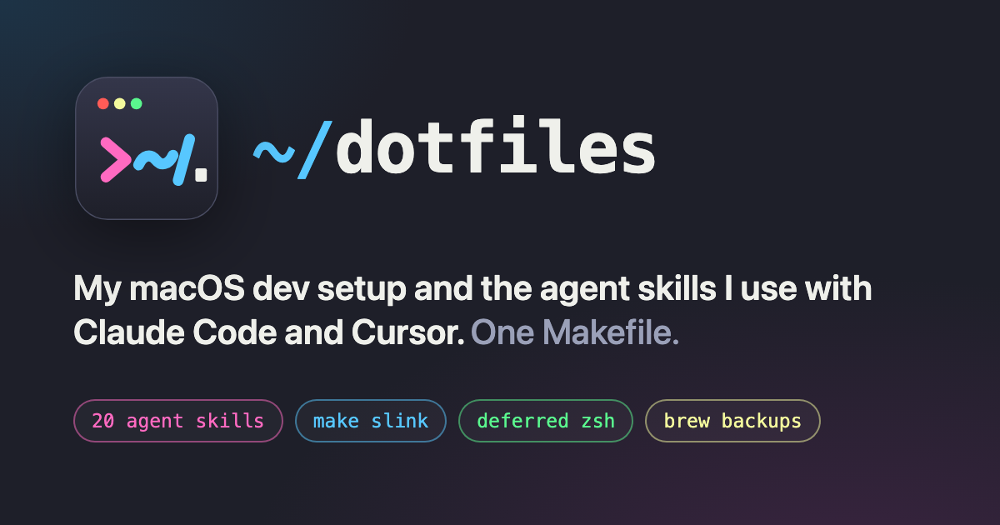
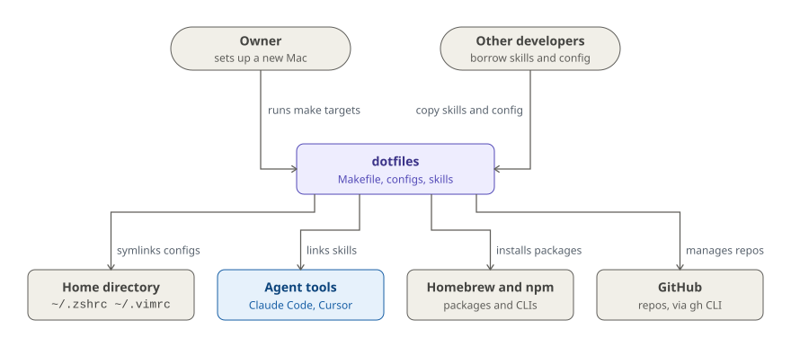

# ~/dotfiles

**My macOS dev setup and 20 agent skills for Claude Code and Cursor, linked into place by one Makefile.**

[](LICENSE) [](skills/) [](#new-mac-setup) [](zsh/.zshrc) [](Makefile)

<br clear="left">

[**Agent skills**](#agent-skills) · [Quick start](#quick-start) · [How it works](#how-it-works) · [Architecture](#architecture) · [New Mac setup](#new-mac-setup)



## Why

A new Mac means a day of remembering which apps, fonts, brew packages and editor
settings you had, and a shell that gets slower every time an installer appends a line to
`.zshrc`. This repo keeps all of it in one place: configs are symlinked into `$HOME`, so
editing a file here changes the live setup, and package lists are regenerated from the
machine instead of maintained by hand.

It is also where my agent skills live. The same `skills/` folder is linked into Claude
Code, Cursor and `~/.agents`, so every tool reads one copy.

It's for me first, and for developers who want to borrow a fast `.zshrc` or a skill. It
isn't a one-command bootstrap for someone else's machine: paths, apps and themes are mine,
and several steps are manual on purpose.

### Design principles

| Principle | In practice |
|---|---|
| Fast shell startup comes first | Every process spawned at startup costs ~25ms on this machine because endpoint security inspects each exec, so `.zshrc` runs no `eval "$(tool init zsh)"` and defers everything the first prompt doesn't need. |
| One copy, symlinked | `~/.zshrc`, `~/.zprofile`, `~/.vimrc` and every skill are links into this repo. |
| Secrets stay out | Machine-specific settings go in `~/.zshrc.local`; private skills go in `~/.skills.local/`. Neither is tracked. |
| Only config for tools in use | Lines installers append are moved into the right section or removed, never left at the end of the file. |

## Quick start

Prerequisites: macOS, `git` and `make` (from the Xcode Command Line Tools,
`xcode-select --install`). The Makefile expects the repo at `~/dotfiles`.

The smallest useful piece is the agent skills, which need nothing else:

```bash
git clone https://github.com/glrodasz/dotfiles.git ~/dotfiles
cd ~/dotfiles
make help          # list every target
make slink-skills  # link skills/* into ~/.claude/skills, ~/.cursor/skills-cursor and ~/.agents/skills
```

Each linked skill replaces any existing skill with the same name in those folders. Open
Claude Code or Cursor and the skills show up as slash commands, e.g. `/branch-test-plan`.

To use the shell config too, install its dependencies (see [New Mac setup](#new-mac-setup))
and run `make slink-zsh`, which replaces `~/.zshrc` and `~/.zprofile` with links.

### New Mac setup

<details>
<summary>The full checklist, in order</summary>

#### Install fundamental apps
1. Install **[Chrome](https://www.google.com/chrome/)**, **[1Password](https://1password.com/downloads/mac/)**, and **[Ghostty](https://ghostty.org/download)**
1. Install **Elgato Camera Hub**, **Elgato Control Center**, **Elgato Stream Deck**, and **Game Capture HD** from [here](https://www.elgato.com/us/en/s/downloads)
1. Install **[Logitech Options+](https://www.logitech.com/en-us/software/logi-options-plus.html)**
1. Install **[Logitech G Hub](https://www.logitechg.com/en-us/innovation/g-hub.html)**
1. Install **Purchased Apps** from the **[App Store](https://support.apple.com/en-us/118212#macOS)**
1. Install **Downloaded Apps** listed in [`apps/installed-apps.json`](apps/installed-apps.json)
1. Install **[Visual Studio Code](https://code.visualstudio.com/download)** and **[Cursor](https://www.cursor.com/downloads)**

#### Configure Git
> (If not available) Install **Git** through the Xcode Command Line Tools: `xcode-select --install`
1. Add the **SSH keys** from 1Password to `~/.ssh` and update permissions: `chmod 400 id_{algorithm}`
1. Add the **SSH key** to the agent: `ssh-add -K ~/.ssh/id_{algorithm}`
1. Set **git name**: `git config --global user.name "Guillermo Rodas"`
1. Set **git email**: `git config --global user.email "<email>@gmail.com"`
1. Clone **dotfiles**: `git clone git@github.com:glrodasz/dotfiles.git ~/dotfiles`

#### Configure Brew
1. Install **brew**: `/bin/bash -c "$(curl -fsSL https://raw.githubusercontent.com/Homebrew/install/HEAD/install.sh)"`
1. Run the commands it prints to make brew available in the path
1. Install **brew packages**: `make install-brew` (includes `starship`, `z` and `zsh-syntax-highlighting`, which `.zshrc` loads)

#### Configure Zsh
> **Linux:** install `sudo apt install zsh` and make it the default shell: `chsh -s $(which zsh)`
1. Install **Oh My Zsh**: `sh -c "$(curl -fsSL https://raw.githubusercontent.com/robbyrussell/oh-my-zsh/master/tools/install.sh)"`
1. Clone **zsh-defer** into a hidden folder: `git clone https://github.com/romkatv/zsh-defer.git ~/.zsh-defer`
1. Link the **zsh config**: `make slink-zsh`

#### Configure the development environment
1. Install **nvm** following [these instructions](https://github.com/nvm-sh/nvm#install--update-script)
1. Install **Active LTS** `nvm install --lts` and **Current** `nvm install node`
1. Install **npm packages**: `make install-npm` (with both the nvm LTS version and the OS Node version)

#### Install fonts
1. Install **Hack Nerd Font** and **JetBrainsMono Nerd Font** from https://www.nerdfonts.com/font-downloads

#### Configure terminals and Vim
1. Set up the **terminals** from [`terminal/`](terminal/): Ghostty, iTerm, Terminal.app and Warp
1. Clone vim-colors-solarized and link **vim**, following [`vim/README.md`](vim/README.md)

#### Configure editors
1. Configure **Visual Studio Code** from [`editors/vscode`](editors/vscode/README.md)
1. Configure **Cursor** from [`editors/cursor`](editors/cursor/README.md)
1. Configure **WebStorm** from [`editors/webstorm`](editors/webstorm/README.md)

#### Configure extra options
1. Configure **macOS** options from [`mac/`](mac/README.md)
1. Configure extra apps from the `DO NOT FORGET to backup` Apple Note
1. Link the **agent skills**: `make slink-skills`

#### Raspberry Pi OS
Follow **Configure Git**, **Configure Zsh**, **Configure the development environment** and
**Configure terminals**, then [`raspberry/README.md`](raspberry/README.md).

</details>

## How it works

Everything runs through `make`. `make help` lists the targets from their `##` comments.

| Group | Targets | What happens |
|---|---|---|
| Symlinks | `slink`, `slink-skills` (`-cursor`, `-claude`, `-agents`), `slink-zsh`, `slink-vim` | Links from `$HOME` into this repo. Skills are every `skills/*/SKILL.md` plus every `~/.skills.local/*/SKILL.md`, linked into `~/.cursor/skills-cursor`, `~/.claude/skills` and `~/.agents/skills`. `make slink` runs skills, zsh and vim. |
| Install | `install`, `install-brew`, `install-npm` | `brew install` everything in `brew/packages`; `npm install -g` `public-ip-cli`, `internal-ip-cli`, `trash-cli`, `vercel` and `serve`. |
| Backup | `backup`, `backup-brew`, `backup-apps`, `backup-npm` | Interactive `whiptail` checklists rewrite `brew/packages` and `apps/installed-apps.json` from what is installed; `backup-npm` prints the global npm packages. |
| Package | `zip-skills` | Zips each skill into `skills/<name>.zip` for uploading to Claude. Files are listed through `git ls-files`, so gitignored data never ships. |

### Fast zsh startup

The shell is tuned around one fact: each process spawned at startup costs ~25ms here.

| Technique | Where |
|---|---|
| `starship init` output is cached in `~/.cache/starship/init.zsh` and regenerated only when the starship binary or `starship.toml` changes. `PROMPT2` is resolved at cache time too. | `.zshrc` |
| Oh My Zsh's libs, git plugin and custom configs are sourced directly instead of through `oh-my-zsh.sh`, whose startup checks spawn ~10 processes. `omz` commands keep working. | `.zshrc` |
| The completion dump is rebuilt only when `fpath` or one of its directories changed; otherwise `compinit -C` loads it without a rescan. | `.zshrc` |
| Tool paths (Go, Ruby, Android, Java, Rust…), `nvm`, the `z` and `poetry` plugins, syntax highlighting, Google Cloud SDK and `~/.zshrc.local` load after the first prompt with [zsh-defer](https://github.com/romkatv/zsh-defer). | `.zshrc` |
| The Homebrew environment is written out statically instead of running `eval "$(brew shellenv zsh)"`. | `.zprofile` |

## Architecture

<picture>
  <source media="(prefers-color-scheme: dark)" srcset="docs/diagrams/context-dark.svg">
  
</picture>

Purple is this repo, blue is the AI coding tools that load the skills, and gray is people
and external systems.

The repo is plain files and a Makefile; nothing runs in the background. The only lasting
effect of `make slink*` is a set of symlinks, so `git pull` updates the live shell and
every agent tool at once, and deleting a link undoes it.

The scripts in `scripts/` are the only part that talks to a remote service: they call the
GitHub API through `gh` to inventory repos or apply branch rulesets and security settings.

**Tech stack** · Shell: zsh, Oh My Zsh, zsh-defer, Starship · Automation: Make, Bash,
whiptail, `gh` + `jq` · Agents: Agent Skills (`SKILL.md`) for Claude Code, Cursor and
`~/.agents` · Packages: Homebrew, npm, nvm, pyenv

## Usage

### Agent skills

| Skill | What it does | Reach for it |
|---|---|---|
| **Git workflow** | | |
| [`branch-test-plan`](skills/branch-test-plan/SKILL.md) | Turns a branch diff into a manual QA plan with regression checks | before opening a PR |
| [`harvest-reviews`](skills/harvest-reviews/SKILL.md) | Distills merged-PR review comments into rules for the team reviewer | after a batch of merged PRs |
| [`reviewable-commits`](skills/reviewable-commits/SKILL.md) | Rebuilds a messy branch into a few logical, reviewable commits | before asking for review |
| [`stacked-pr-splitter`](skills/stacked-pr-splitter/SKILL.md) | Redesigns an oversized PR as a set of small stacked pull requests | when a PR is too big |
| [`team-reviewer`](skills/team-reviewer/SKILL.md) | Reviews a diff the way your teammates would, from their past comments | before requesting human review |
| **Code quality** | | |
| [`branch-comment-cleanup`](skills/branch-comment-cleanup/SKILL.md) | Strips filler comments and makes the code explain itself instead | tidying a diff before review |
| [`feature-based-architecture`](skills/feature-based-architecture/SKILL.md) | Organizes a codebase by feature, with atomic UI and design tokens | deciding where a file belongs |
| [`minimal-code-changes`](skills/minimal-code-changes/SKILL.md) | Keeps every edit surgical: no drive-by refactors or cleanups | any edit to existing code |
| [`quantum-design-tokens`](skills/quantum-design-tokens/SKILL.md) | Moves hardcoded UI values onto a three-tier design token system | replacing hardcoded colors and spacing |
| **Web audit** | | |
| [`a11y-page-audit`](skills/a11y-page-audit/SKILL.md) | Audits a page for keyboard and screen-reader gaps, then fixes them | before shipping a page |
| [`light-dark-mode`](skills/light-dark-mode/SKILL.md) | Adds light/dark mode with no flash, OS sync and an accessible toggle | when a site needs dark mode |
| [`localization`](skills/localization/SKILL.md) | Adds languages to a site with locale URLs, a toggle and hreflang | adding a language to a site |
| [`prod-page-audit`](skills/prod-page-audit/SKILL.md) | Checks SEO, favicon, OG previews and mobile before you go live | on the way to production |
| **Tooling** | | |
| [`context7-mcp`](skills/context7-mcp/SKILL.md) | Pulls real library docs from Context7 instead of guessing from memory | any library or framework question |
| [`env-example-sync`](skills/env-example-sync/SKILL.md) | Aligns your `.env` with `.env.example` and flags the leftovers | after pulling |
| [`great-readme`](skills/great-readme/SKILL.md) | Rewrites a README as a product page with a quick start and C1 diagram | before publishing an open source repo |
| **Meta** | | |
| [`shell-aliases-social`](skills/shell-aliases-social/SKILL.md) | Exports your best shell aliases as a shareable JSON catalog | when sharing your dotfiles |
| [`skill-best-practices-sync`](skills/skill-best-practices-sync/SKILL.md) | Refreshes the upstream skill-authoring guides and the local digest | before auditing your skills |
| [`skills-audit`](skills/skills-audit/SKILL.md) | Reviews every skill against the best practices, then standardizes them | after adding or editing a skill |
| [`skills-social`](skills/skills-social/SKILL.md) | Exports your skills as a shareable JSON catalog for a social card | when sharing your skills setup |

Private or machine-specific skills go in `~/.skills.local/<name>/SKILL.md`; `make
slink-skills` links them next to these. More in [`skills/README.md`](skills/README.md).

### Shell aliases and functions

A few from [`zsh/.zshrc`](zsh/.zshrc):

| Command | Does |
|---|---|
| `gwin` | Stage everything and commit with `chore: commit changes` |
| `gfresh` | Check out main, fetch and pull |
| `greb` | Interactive rebase from where the branch left `origin/main` |
| `fbr` | Fuzzy-find a local or remote branch with `fzf` and check it out |
| `npmd` / `pnpmd` / `yarnd` / `denod` | Run the dev script with any package manager |
| `rmnpmi` | Delete `node_modules`, clean the npm cache and reinstall |
| `findport` / `killport` | Show or kill whatever listens on one or more ports |
| `secret` | Print a random 32-byte hex secret |
| `rm` | Move to the trash instead of deleting (`trash-cli`) |

### Scripts

- [`scripts/github-audit.sh`](scripts/README.md#github-audit) inventories every repo of a
  GitHub user or org into `scripts/github-audit/` (gitignored).
- [`scripts/harden-repos.sh`](scripts/README.md#harden-repos) applies a default-branch
  ruleset, squash-only merging, Dependabot and a read-only `GITHUB_TOKEN`, per visibility,
  with a `--dry-run` preview.
- [`raycast/scripts/`](raycast/scripts/) has three Raycast commands that open a URL or a
  Google search in a specific Chrome profile (work, private, public).

### Project layout

```
dotfiles/
├── Makefile       # every install, link and backup target
├── zsh/           # .zshrc and .zprofile
├── skills/        # agent skills, one folder per skill
├── scripts/       # GitHub audit and hardening scripts
├── brew/          # brew/packages and its backup script
├── apps/          # installed-apps.json and its backup script
├── npm/           # global npm packages
├── terminal/      # Ghostty, iTerm, Terminal.app and Warp setup
├── editors/       # VS Code, Cursor and WebStorm setup
├── vim/           # .vimrc and solarized colors
├── raycast/       # Raycast script commands
├── mac/           # macOS settings
└── raspberry/     # Raspberry Pi OS setup
```

## Documentation

| Doc | What's in it |
|---|---|
| [`skills/README.md`](skills/README.md) | Installing skills, local skills, keeping them consistent, the shareable catalog |
| [`scripts/README.md`](scripts/README.md) | `github-audit.sh` and `harden-repos.sh`: flags, profiles and what each setting does |
| [`AGENTS.md`](AGENTS.md) | Conventions for editing this repo, especially the zsh comment style and startup rules |
| [`brew/README.md`](brew/README.md), [`apps/README.md`](apps/README.md), [`npm/README.md`](npm/README.md) | Installing from and regenerating each backup |
| [`terminal/`](terminal/) | Theme, font and window settings for [Ghostty](terminal/ghostty/README.md), [iTerm](terminal/iterm/README.md), [Terminal.app](terminal/mac/README.md) and [Warp](terminal/warp/README.md) |
| [`editors/`](editors/) | Settings sync and themes for [VS Code](editors/vscode/README.md), [Cursor](editors/cursor/README.md) and [WebStorm](editors/webstorm/README.md) |
| [`vim/README.md`](vim/README.md) | Cloning solarized and linking `.vimrc` |
| [`mac/README.md`](mac/README.md) | Screen saver and lock screen settings |
| [`raspberry/README.md`](raspberry/README.md) | Packages, fonts and prompt for Raspberry Pi OS |

## Contributing

- **Add a skill**: create `skills/<name>/SKILL.md` with `name` and `description`
  frontmatter, check it with `python3 skills/skills-audit/scripts/lint_skills.py`, then run
  `make slink-skills`. Regenerate the catalog with the `skills-social` skill.
- **Change the shell**: follow [`AGENTS.md`](AGENTS.md), then check the syntax with
  `zsh -n zsh/.zshrc` and the startup time with
  `for i in $(seq 1 10); do /usr/bin/time zsh -i -c exit; done`.
- **Keep backups current**: run `make backup`, follow the steps in each folder's README,
  and commit the changes.

## License

[MIT](LICENSE) © 2026 Guillermo Rodas.

The Snazzy terminal color schemes are from [Sindre Sorhus's Snazzy](https://github.com/sindresorhus/iterm2-snazzy).
[vim-colors-solarized](https://github.com/altercation/vim-colors-solarized) by Ethan
Schoonover is cloned separately and keeps its own license.
